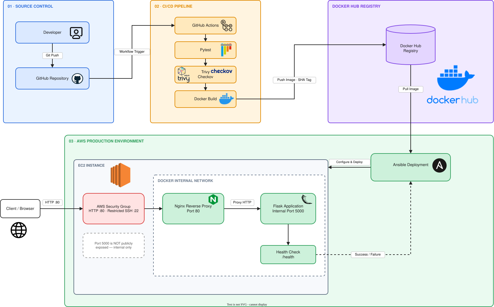

<div align="center">

# 🚀 Secure Flask CI/CD Pipeline on AWS

**A security-gated, fully automated delivery pipeline: from `git push` to a hardened, health-verified container deployment on AWS EC2.**

[](#-cicd-pipeline-workflow)
[](#%EF%B8%8F-tech-stack--security-hardening)
[](#-cicd-pipeline-workflow)
[](#%EF%B8%8F-security-gates--vulnerability-scanning)
[](#-getting-started--deployment)
[](#-architecture--data-flow)
[](#%EF%B8%8F-tech-stack--security-hardening)
[](#-architecture--data-flow)

</div>

---

## 📑 Table of Contents

1. [Introduction](#-introduction)
2. [Architecture & Data Flow](#-architecture--data-flow)
3. [Tech Stack & Security Hardening](#%EF%B8%8F-tech-stack--security-hardening)
4. [CI/CD Pipeline Workflow](#-cicd-pipeline-workflow)
5. [Security Gates & Vulnerability Scanning](#%EF%B8%8F-security-gates--vulnerability-scanning)
6. [Task 8: Failure Simulation & Rollout Recovery](#-task-8-failure-simulation--rollout-recovery)
7. [Getting Started & Deployment](#-getting-started--deployment)

---

## 🚀 Introduction

This project demonstrates a production-style **DevSecOps delivery pipeline** for a containerized **Flask** application. Every change pushed to the repository is automatically tested, scanned for vulnerabilities and misconfigurations, packaged as an immutable Docker image, published to **Docker Hub**, and rolled out to **AWS EC2** with **Ansible**, where it is verified by a smoke test before the release is considered successful.

**Design goals**

| Goal | How it is achieved |
|---|---|
| 🔒 **Secure by default** | Read-only container filesystem, all Linux capabilities dropped, minimal network exposure |
| 🚦 **Shift-left security** | Trivy and Checkov act as blocking gates *before* an image is published |
| 🧱 **Immutable releases** | Images are tagged with the Git commit SHA, so every deployment is traceable and reproducible |
| ♻️ **Reliable rollouts** | `/health` smoke test after deploy, with a rollback path for failed releases |
| 🤖 **Zero manual steps** | One `git push` drives the entire path to production |

---

## 🏛️ Architecture & Data Flow



📐 [View editable architecture](docs/architecture.drawio) (open with [diagrams.net](https://app.diagrams.net))

### Three-tier design

| Tier | Responsibility | Components |
|---|---|---|
| **1 · Source Control** | Single source of truth; triggers automation | Developer → GitHub Repository |
| **2 · CI/CD & Registry** | Build, test, scan, and publish artifacts | GitHub Actions (Pytest, Trivy, Checkov, Docker Build) → Docker Hub |
| **3 · AWS Production** | Run the application securely | Ansible → EC2 → Security Group → Docker network (Nginx → Flask) |

### Data flow

The diagram separates two distinct traffic paths:

**📦 Deployment path (control plane)**

1. Developer runs `git push` to GitHub.
2. A workflow trigger starts GitHub Actions.
3. The pipeline runs Pytest, Trivy / Checkov, then builds the Docker image.
4. The image is pushed to **Docker Hub** with a **commit-SHA tag**.
5. **Ansible** deploys to EC2, **pulling the image** from Docker Hub and applying configuration.
6. A health check on `/health` returns **Success / Failure** to the deployment logic.

**🌐 Runtime path (data plane)**

1. A client sends `HTTP :80` traffic to the EC2 **Security Group**.
2. Allowed traffic reaches **Nginx** (reverse proxy, port 80).
3. Nginx forwards the request (`Proxy HTTP`) to **Flask** on internal port **5000**.

> 🔐 **Flask port 5000 is never exposed to the public internet.** It is reachable only from Nginx over the internal Docker network.

---

## 🛠️ Tech Stack & Security Hardening

### Technology stack

| Layer | Technology | Purpose |
|---|---|---|
| Application |   | Web application with `/health` endpoint |
| Containers |   | Packaging and multi-container orchestration |
| Reverse proxy |  | Public entry point on port 80 |
| CI/CD |  | Pipeline orchestration |
| Testing |  | Automated unit/integration tests |
| Security | Trivy · Checkov | Vulnerability and configuration scanning |
| Registry |  | Versioned image storage |
| Deployment |  | Idempotent deployment automation |
| Cloud |  | Production host |

### Security hardening measures

| Control | Implementation | Threat mitigated |
|---|---|---|
| **Read-only root filesystem** | `read_only: true` | Prevents tampering, malware persistence, and runtime file writes |
| **Dropped capabilities** | `cap_drop: ALL` | Removes kernel privileges the app never needs |
| **Network isolation** | Flask only on the internal Docker network | Eliminates direct public access to the app server |
| **Single public port** | Security Group allows `HTTP :80` only | Minimizes attack surface |
| **Restricted SSH** | Port `22` limited to trusted source IP(s) | Reduces brute-force and unauthorized access risk |
| **Immutable image tags** | Commit-SHA tags | Traceability and deterministic rollbacks |

Reference Compose hardening (adapt names to your `docker-compose.yml`):

```yaml
services:
  flask-app:
    image: ${DOCKERHUB_USERNAME}/flask-app:${IMAGE_TAG}
    read_only: true
    cap_drop:
      - ALL
    tmpfs:
      - /tmp
    expose:
      - "5000"            # internal only, never published to the host
    networks:
      - internal

  nginx:
    image: nginx:stable
    ports:
      - "80:80"           # the only published port
    depends_on:
      - flask-app
    read_only: true
    cap_drop:
      - ALL
    cap_add:
      - NET_BIND_SERVICE
    networks:
      - internal

networks:
  internal:
    driver: bridge
```

> ℹ️ Nginx may need `tmpfs` mounts (e.g. `/var/cache/nginx`, `/var/run`) when running with a read-only filesystem, and `NET_BIND_SERVICE` to bind port 80 after dropping all capabilities.

---

## 🔄 CI/CD Pipeline Workflow

The pipeline is defined in `.github/workflows/` and runs on every push.

```text
git push ──► GitHub Actions ──► Pytest ──► Trivy / Checkov ──► Docker Build
                                                                   │
                                       Push Image · SHA Tag        ▼
        AWS EC2  ◄── Ansible Deploy ◄── Pull Image ◄──────── Docker Hub
            │
            └──► Smoke test /health ──► Success / Failure
```

| # | Stage | Description | Gate |
|---|---|---|---|
| 1 | **Source** | Developer pushes code; the workflow trigger starts the pipeline | – |
| 2 | **Test** | Pytest validates application behavior | ❌ Fails the pipeline on test failure |
| 3 | **Scan** | Trivy (vulnerabilities) and Checkov (configuration/IaC) | ❌ Fails on blocking findings |
| 4 | **Build** | Docker image built from the verified source | ❌ Fails on build error |
| 5 | **Publish** | Image pushed to Docker Hub tagged with the **commit SHA** | – |
| 6 | **Deploy** | Ansible connects to EC2, pulls the image, and applies the Compose configuration | ❌ Fails on deployment error |
| 7 | **Verify** | Smoke test on `/health` validates the new release | ❌ Failed health check triggers recovery |

**Principle:** nothing reaches the registry unless it passes testing and security scanning, and nothing is considered released until it passes a live health check.

### Required GitHub Secrets

| Secret | Purpose |
|---|---|
| `DOCKERHUB_USERNAME` | Docker Hub account |
| `DOCKERHUB_TOKEN` | Docker Hub access token (not your password) |
| `EC2_HOST` | Public IP / DNS of the EC2 instance |
| `EC2_SSH_KEY` | Private key used by Ansible to reach EC2 |

---

## 🛡️ Security Gates & Vulnerability Scanning

Security is enforced as **automated, blocking gates**, not as an afterthought.

### 🔍 Trivy: vulnerability scanning

| | |
|---|---|
| **Scope** | OS packages and Python dependencies in the container image |
| **Detects** | Known CVEs, ranked by severity |
| **Gate behavior** | Pipeline fails on `HIGH` / `CRITICAL` findings (configurable threshold) |

```bash
trivy image --severity HIGH,CRITICAL --exit-code 1 <image>:<tag>
```

### 🧾 Checkov: configuration & IaC scanning

| | |
|---|---|
| **Scope** | Dockerfile, Docker Compose, and other infrastructure/config files |
| **Detects** | Misconfigurations such as running as root, missing healthchecks, and insecure settings |
| **Gate behavior** | Pipeline fails on failed policy checks |

```bash
checkov -d . --framework dockerfile
```

### Defense in depth

| Layer | Control |
|---|---|
| Code & dependencies | Pytest + Trivy |
| Configuration | Checkov |
| Container runtime | Read-only FS, `cap_drop: ALL` |
| Network | Security Group, internal Docker network, Nginx-only ingress |
| Release integrity | SHA-tagged images, health-gated rollout |

---

## 🧪 Task 8: Failure Simulation & Rollout Recovery

A pipeline is only trustworthy if its **failure path** is proven. This task deliberately breaks a release to verify that bad deployments are detected and contained.

### Mechanism

| Component | Role |
|---|---|
| `/health` endpoint | Reports application readiness |
| Smoke test | Probes `/health` immediately after deployment |
| `FAIL_HEALTH` flag | Simulates a faulty release by forcing the health check to fail |
| Recovery logic | Restores the last known-good image when the smoke test fails |

### Failure scenario walkthrough

```text
1. Deploy release (FAIL_HEALTH enabled)
2. Container starts; /health reports failure
3. Smoke test detects Failure
4. Rollout is marked failed
5. Rollback redeploys the previous known-good (SHA-tagged) image
6. /health returns Success; service is restored
```

### Why this works

- **Fast detection:** failures are caught seconds after rollout, before users are affected.
- **Deterministic recovery:** SHA-tagged images make the previous version unambiguous.
- **Blast-radius control:** Nginx fronts the app, so the public entry point stays stable during recovery.
- **Proven, not assumed:** the failure path is exercised on purpose through `FAIL_HEALTH`.

### Run the simulation

```bash
# Simulate a failed release
FAIL_HEALTH=true <your-deploy-command>

# Verify the service after recovery
curl -i http://<EC2_PUBLIC_IP>/health
```

> 📝 Adjust variable names and commands to match your playbook and workflow. Expected outcome: the deployment reports **Failure**, rollback runs, and `/health` returns `200 OK`.

---

## 📦 Getting Started & Deployment

### Prerequisites

| Tool | Purpose |
|---|---|
| Docker & Docker Compose | Local run and containerization |
| Python 3.x | Local development and tests |
| Git | Source control |
| Ansible | Cloud deployment |
| AWS account | EC2 hosting |
| Docker Hub account | Image registry |

### 1️⃣ Clone the repository

```bash
git clone https://github.com/noran-salm/flask-devops-ci-pipeline.git
cd flask-devops-ci-pipeline
```

### 2️⃣ Run tests locally

```bash
python -m venv .venv && source .venv/bin/activate
pip install -r requirements.txt
pytest
```

### 3️⃣ Run locally with Docker Compose

```bash
docker compose up --build -d
curl -i http://localhost/health
docker compose down
```

Only Nginx (port 80) is published; Flask on 5000 remains internal.

### 4️⃣ Provision the AWS environment

1. Launch an **EC2** instance with Docker installed.
2. Create a **Security Group** with:

| Port | Source | Purpose |
|---|---|---|
| `80` | `0.0.0.0/0` | Public HTTP via Nginx |
| `22` | `0.0.0.0/0` | SSH for CI/CD (Ansible) & Admin Access |
| `5000` | *(no rule)* | Internal only, never exposed |

3. Add the GitHub Secrets listed in the [pipeline section](#required-github-secrets).

### 5️⃣ Deploy

**Automated (recommended):** push to the configured branch and the pipeline handles everything.

```bash
git push origin main
```

**Manual (Ansible):**

```bash
ansible-playbook -i inventory.ini deploy.yml -e image_tag=<commit-sha>
```

### 6️⃣ Verify

```bash
curl -i http://<EC2_PUBLIC_IP>/health        # expect 200 OK
curl -m 5 http://<EC2_PUBLIC_IP>:5000/       # expect timeout / refused
```

### 🧹 Teardown

```bash
docker compose down
# Terminate the EC2 instance and release resources in AWS to avoid charges
```

---

## 📁 Repository Layout (reference)

```text
.
├── app/                    # Flask application
├── tests/                  # Pytest suite
├── nginx/                  # Nginx reverse-proxy config
├── ansible/                # Inventory and deployment playbook
├── docs/
│   ├── architecture.svg
│   └── architecture.drawio
├── .github/workflows/      # CI/CD pipeline
├── Dockerfile
├── docker-compose.yml
└── README.md
```

> Adjust to match your actual structure.

---

<div align="center">

**Built with a focus on security, automation, and reliability.** 🛡️

</div> 